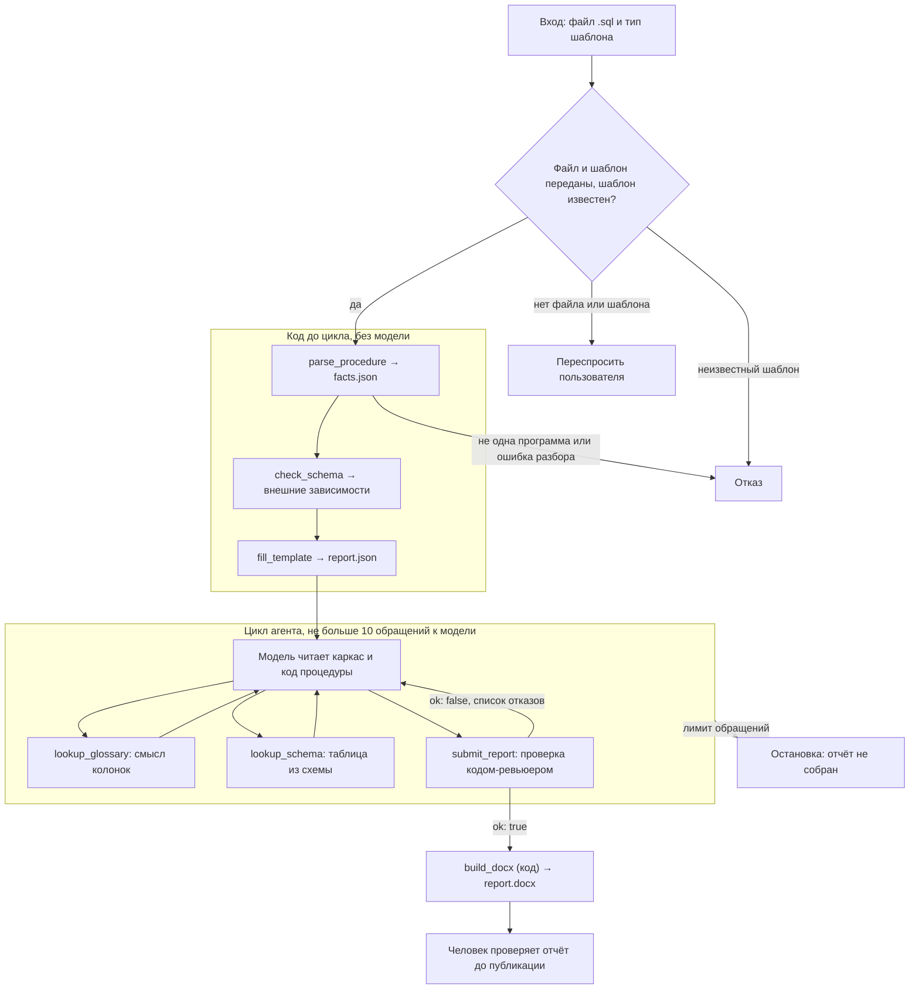

# С1. Описание хранимой процедуры в .docx

## Команда

Егор Гудков.

## Задача

В компании бизнес-логика транспортных процессов живёт в хранимых процедурах PostgreSQL на
plpgsql: приём сообщений, регистрация заявок, расчёт планов, отчётные функции. На каждую
такую программу нужен структурированный отчёт в .docx, и у каждого типа задачи свой шаблон.
Сейчас отчёты пишут руками. Агент получает файл с процедурой и тип шаблона, разбирает код,
строит отчёт по шаблону и отдаёт .docx вместе с замечаниями: что в коде осталось неясным,
где комментарий противоречит коду, какие внешние зависимости не описаны. Человек проверяет
отчёт до публикации.

Главное требование: **в отчёте нет ни одной таблицы, функции, параметра или статуса,
которых нет в разборе кода.** Разбор делает инструмент, текст пишет модель, проверяет
отдельный ревьюер. Это главный тест проекта.

## Вход

Файл `.sql` с одной процедурой или функцией plpgsql; тип шаблона («описание
процесса» или «описание интеграции»); по желанию схема базы для сверки имён.

## Выход

Отчёт `.docx` по разделам шаблона; список замечаний: неясные места,
комментарии, противоречащие коду, внешние зависимости без определения, пустые разделы;
извлечённые факты в JSON для проверки.

## Стек технологий

- Python 3.11+.
- LLM через прокси курса (OpenAI-совместимый API), модель на выбор команды.
- Логирование вызовов инструментов: файл, SQLite или Langfuse.
- pytest для тестовых кейсов.
- Разбор SQL и plpgsql: библиотека `pglast` (обёртка над парсером PostgreSQL, есть `parse_plpgsql`), при необходимости свой обход дерева.
- Сборка docx: python-docx по шаблону; модель к docx не прикасается.
- Глоссарий и сделанные отчёты: SQLite или JSON.
- Интерфейс: веб-форма.

## Данные

Для отладки агента в `data/` лежат схема учебной базы и четыре процедуры. Состав разделов
отчёта для каждого типа шаблона команда берёт из своих рабочих шаблонов и описывает в решении.

### `data/schema.sql`

Схема учебной базы: справочники дорог, станций, родов вагонов, клиентов и операций, очередь
входящих сообщений, дислокация и журнал операций по вагонам, парк, заявки ГУ-12 с историей
статусов, суточный план подач, факт выгрузки и месячный план. Имена колонок те же, что в
витринах набора курса; их смысл описан в `datamarts.student.json` набора курса.

### `data/procedures/` — четыре программы разной формы и разного качества

| Файл | Что делает | Чем интересна |
|---|---|---|
| `01_accept_disloc_message.sql` | процедура принимает сообщение о вагонной операции из очереди, проверяет, пишет журнал, обновляет дислокацию и парк, ставит статус сообщению | подробные комментарии, идемпотентность по идентификатору сообщения, блокировка строки, опоздавшие сообщения, блок обработки исключений по кодам |
| `02_register_gu12_order.sql` | функция регистрирует заявку ГУ-12: восемь проверок, поиск дубля, автоподтверждение до 50 вагонов, вызов внешней функции уведомления | комментариев нет совсем, описание строится только по коду; внешняя функция в схеме не определена |
| `03_build_daily_supply_plan.sql` | процедура строит суточный план подач: удаляет старый план, собирает свободный парк во временную таблицу, курсором раздаёт вагоны по заявкам, меняет статусы | комментарии местами врут: «в порядке приоритета клиента», а в коде сортировка по времени создания; временная таблица, `GET DIAGNOSTICS`, `CONTINUE` в цикле |
| `04_road_unload_report.sql` | функция возвращает таблицу: факт выгрузки по станциям дороги против месячного плана, приведённого к дням периода | `RETURNS TABLE`, `STABLE`, несколько CTE и подзапрос в выражении, три проверки без кодов ошибок |

## Решение

Решение делится на две части: шаги без выбора выполняет код, шаги с решениями — модель.

**Код** делает всё, что всегда идёт в одном порядке: принимает вход, разбирает процедуру, сверяет её со схемой, раскладывает факты по шаблону, проверяет текст модели и собирает `.docx`.

**Модель** делает то, где нужен выбор: пишет текст разделов, находит комментарии, которые противоречат коду, и неясные места. Для этого у неё три инструмента:

- `lookup_glossary` — узнать смысл колонки (например, `rsv_st_code` — код станции назначения);
- `lookup_schema` — посмотреть таблицу в `data/schema.sql` или убедиться, что объекта там нет;
- `submit_report` — сдать текст разделов и замечания на проверку.

Модель сама решает, какие имена посмотреть в глоссарии и схеме, что считать неясным и когда отчёт готов к сдаче. Проверку делает не модель, а код-ревьюер внутри `submit_report`, поэтому главное требование гарантирует код, а не промпт.

### Схема пайплайна



### Шаги

**Шаг 0. Приём входа (код).** Код проверяет, что переданы файл `.sql` и тип шаблона. Если чего-то нет, он переспрашивает пользователя. Неизвестный тип шаблона — отказ. Модель на этом шаге не вызывается.

**Шаг 1. `parse_procedure` (код).** Читает файл с диска и пишет `facts.json`:

- `pglast.parse_plpgsql` даёт дерево тела с номерами строк операторов. SQL внутри оператора приходит строкой, код разбирает его отдельно через `pglast.parse_sql` и берёт номер строки оператора.
- Из дерева извлекаются параметры, таблицы с действиями, статусы, вызовы, проверки и сортировки. У каждого факта есть `id` и `line`. Таблицы, которые создаёт сама программа (временные таблицы, CTE), получают `defined_here: true`.
- Комментарии `--` код находит регулярным выражением и записывает с номером строки и `id` вида `c13`. К операторам комментарии не привязываются: модель видит код с номерами строк и сама сопоставляет комментарий с кодом рядом.
- `allowed_words` — все латинские слова исходника: идентификаторы, ключевые слова и строковые константы. По этому списку работает код-ревьюер.

Отказ: в файле не одна программа plpgsql или код не разобран.

**Шаг 2. `check_schema` (код).** Сверяет таблицы и вызовы из `facts.json` с `data/schema.sql`. Не проверяются:

- объекты с `defined_here: true`, например `tmp_free_park` в `03` и CTE `days`, `fact`, `plan` в `04`;
- встроенные функции PostgreSQL (`count`, `sum`, `upper`, `btrim`, `now`, `round`, `generate_series` и другие). Их список лежит в коде.

Всё остальное, чего нет в схеме, становится замечанием `external_dependency`.

**Шаг 3. `fill_template` (код).** По `templates.json` раскладывает факты по разделам выбранного шаблона и создаёт `report.json`. У каждого раздела есть `id`, `title`, `facts`, пустой `text` и поле `review`. Раздел с фактами получает `review: "pending"`, раздел без фактов — `review: "empty"` и замечание `empty_section`, модель его не пишет.

**Шаг 4. Цикл агента (модель).** Модель получает каркас `report.json`, код процедуры с номерами строк и замечания `check_schema`. Дальше она сама выбирает инструменты:

- `lookup_glossary` — когда из имени колонки непонятен её смысл;
- `lookup_schema` — когда нужно посмотреть колонки таблицы или проверить, есть ли объект в схеме;
- `submit_report` — когда текст всех разделов и замечания готовы.

В замечаниях модель указывает:

- `comment_contradicts_code` — комментарий не совпадает с кодом рядом;
- `unclear` — место в коде, смысл которого из кода не ясен.

**Шаг 5. `submit_report` (модель вызывает, проверяет код).** Код-ревьюер:

1. Записывает текст разделов в `report.json`. Разделы `ok`, `empty` и `closed` не перезаписываются и возвращаются в `skipped`.
2. Из каждой фразы и каждого замечания достаёт все латинские слова (`[A-Za-z_][A-Za-z0-9_]*`) и без учёта регистра сравнивает их с `allowed_words` и коротким списком общих слов (`SQL`, `PostgreSQL`, `plpgsql`, `JSON`). Раздел без лишних слов получает `ok`, с лишними — `rejected`, лишние слова записываются в `unknown_names`.
3. Раздел с фактами, для которого модель не прислала текст, тоже получает `rejected` с причиной `no_text`.
4. Отклоняет замечание, если какого-то из его `fact_ids` нет в `facts.json` или в тексте есть лишние слова.

Если отказов нет, инструмент возвращает `ok: true`.

**Шаг 6. Повтор.** Если есть отказы, инструмент возвращает `ok: false` со списком отклонённых разделов и замечаний. Модель присылает исправления только для них. Вторая сдача последняя:

- раздел, который снова не прошёл проверку, закрывается: `review: "closed"`, замечание `unknown_name` или `no_text`, в `.docx` раздел не идёт;
- замечание, которое снова не прошло проверку, отбрасывается и остаётся только в журнале.

После второй сдачи инструмент всегда возвращает `ok: true`, поэтому бесконечно переписывать раздел нельзя.

**Шаг 7. `build_docx` (код).** Как только `submit_report` вернул `ok: true`, код завершает цикл и собирает `.docx` через python-docx из разделов `ok` и всех замечаний. Модель этот шаг не вызывает и к файлу не прикасается. Человек читает отчёт до публикации.

### Что считается фактом

| Вид | Что это | Пример |
|---|---|---|
| `parameter` | параметр программы | `p_plan_date` |
| `object` | таблица, с которой работает программа, и действия с ней: `select`, `insert`, `update`, `delete` | `gu12_order`: `select`, `update` |
| `status` | строковая константа, которую сравнивают с колонкой `status`, `state`, `old_status`, `new_status` или записывают в неё; текст `reason` и сообщения `RAISE` статусами не считаются | `'CONFIRMED'`, `'FREE'` |
| `call` | вызов функции или процедуры, кроме встроенных | `fn_notify_dispatcher` |
| `check` | `IF ... RAISE EXCEPTION`: условие, текст и код ошибки, если он есть | `P0006` |
| `ordering` | `ORDER BY` с колонками | `created_at` |
| `comment` | строка `--` с номером строки | `c13` |

`id` фактов строится по виду и имени: `par_p_plan_date`, `obj_gu12_order`, `st_confirmed`, `call_fn_notify_dispatcher`. Проверки и сортировки нумеруются по порядку в коде: `chk_1`, `ord_1`. Комментарии получают номер своей строки: `c13`.

### Шаблоны

Разделы шаблонов и правило «какой вид факта идёт в какой раздел» лежат в `templates.json`. Раздел `statuses` есть в обоих шаблонах, чтобы пустые статусы попадали в замечания.

| `id` раздела | «описание процесса» | «описание интеграции» | Факты |
|---|---|---|---|
| `purpose` | Назначение | Назначение | имя и вид программы, комментарии перед `CREATE` |
| `params` | Параметры | Входные данные | `parameter` |
| `checks` | Проверки | Проверки входных данных | `check` |
| `objects` | Таблицы и действия | Затрагиваемые таблицы | `object` |
| `steps` | Порядок обработки | — | `ordering` и комментарии внутри тела |
| `statuses` | Статусы | Статусы | `status` |
| `calls` | Внешние вызовы | Вызовы смежных систем | `call` |

### Пример: комментарий против кода в `03`

Комментарий на строке 13 стоит перед объявлением курсора, а сортировка курсора на строке 20 идёт по `created_at`. В `facts.json` это два отдельных факта:

```json
{
  "comments": [
    {"id": "c13", "kind": "comment", "line": 13, "text": "заявки берём в порядке приоритета клиента"}
  ],
  "orderings": [
    {"id": "ord_1", "kind": "ordering", "line": 20, "columns": ["created_at"]}
  ]
}
```

Модель видит код с номерами строк, сравнивает комментарий с сортировкой и передаёт в `submit_report` замечание:

```json
{
  "kind": "comment_contradicts_code",
  "fact_ids": ["c13", "ord_1"],
  "text": "Комментарий говорит о порядке по приоритету клиента, а курсор сортирует заявки по created_at."
}
```

## Память

Один запуск строит один отчёт. Между запусками модель ничего не помнит, прошлые отчёты в новый запрос не подставляются.

Состояние запуска хранит код, а не модель. Каждый запуск пишет в свою папку `runs/<дата-время>_<имя программы>/`:

- `facts.json` — факты разбора и `allowed_words`;
- `report.json` — разделы с текстом и статусом проверки, номер сдачи и замечания;
- `log.jsonl` — журнал: по строке на каждое обращение к модели и каждый вызов инструмента с аргументами и ответом;
- `report.docx` — готовый отчёт.

Папка `runs/` — это и есть архив сделанных отчётов.

Глоссарий лежит в `glossary.json`: имя колонки и её описание. Код один раз собирает его из колонок витрин в `data/datamarts.student.json`, недостающие имена можно дописать руками.

## Инструменты

> **Внимание:** [tools.json](tools.json) — набросок схем шагов кода и инструментов модели, а не финальная версия. Поля и форматы ответов могут меняться при реализации.

### Шаги кода

Модель их не вызывает, код выполняет их по порядку до и после цикла.

| Шаг | Вход | Выход | Что делает |
|---|---|---|---|
| `parse_procedure` | путь к файлу `.sql` | `ok`; `error` — `not_one_routine` или `parse_error`; `routine` — вид и имя; `facts` — параметры, таблицы, статусы, вызовы, проверки, сортировки, комментарии; `allowed_words` | Разбирает одну процедуру или функцию plpgsql и пишет `facts.json`. |
| `check_schema` | `facts.json`, `data/schema.sql` | `remarks` — таблицы и вызовы, которых нет в схеме | Сверяет зависимости со схемой, пропуская объекты с `defined_here` и встроенные функции. |
| `fill_template` | тип шаблона, `facts.json`, `templates.json` | `report.json` — разделы с `id`, `title`, `facts`, пустым `text`, `review`; замечания `empty_section` | Раскладывает факты по разделам шаблона. |
| `build_docx` | `report.json` | путь к `report.docx` | Собирает `.docx` из разделов `ok` и всех замечаний. |

### Инструменты модели

В каждом ответе есть `ok`. При ошибке инструмент возвращает `error` и `hint` с подсказкой, что делать дальше.

| Инструмент | Вход | Выход | Что делает |
|---|---|---|---|
| `lookup_glossary` | `names` — список имён колонок | `found` — имя и описание; `not_found` — имена, которых нет в глоссарии | Ищет смысл колонок в `glossary.json`. Только читает. |
| `lookup_schema` | `names` — список имён таблиц или функций | `found` — таблица и её колонки с типами и комментариями из схемы; `not_found` — имена, которых в схеме нет | Ищет объекты в `data/schema.sql`. Только читает. |
| `submit_report` | `sections` — список `{id, text}`; `remarks` — список `{kind, fact_ids, text}`, где `kind` — `comment_contradicts_code` или `unclear` | `ok`; `submission` — номер сдачи; `accepted` — принятые разделы; `rejected` — отклонённые разделы с `unknown_names` или причиной `no_text`; `bad_remarks` — отклонённые замечания с причиной; `skipped`; `closed` — разделы, закрытые после второй сдачи; `hint` | Записывает текст в `report.json` и проверяет его кодом-ревьюером. `ok: true` завершает цикл. |

Имена, которые модель увидела через `lookup_glossary` и `lookup_schema`, в `allowed_words` не добавляются. Например, статусы `ASSIGNED` и `REPAIR` из комментария к `wagon_park` в схеме есть, но в коде `03` их нет, поэтому в отчёт по `03` они не попадут.

## Контекст

В каждый запрос к модели входят:

- постоянный текст: роль, задача и правила из раздела «Управление рассуждением»;
- схемы трёх инструментов модели;
- первое сообщение запуска: тип шаблона, текст процедуры с номерами строк, каркас `report.json` с фактами по разделам и замечания `check_schema`;
- диалог запуска: вызовы инструментов и их ответы, поэтому модель видит, что уже сделано.

Текст процедуры модель только читает, чтобы понимать логику и находить неясные места. Имена во фразах всё равно проверяются по `allowed_words`. Схема и глоссарий целиком в окно не входят, модель получает только то, что запросила через `lookup_schema` и `lookup_glossary`. Прошлые отчёты в окно не входят.

## Управление рассуждением

Модель сама выбирает, какие инструменты вызвать и в каком порядке. Выбор модели вероятностный, поэтому правила ниже держит код, а не промпт.

1. **Вход проверяется до цикла.** Нет файла или шаблона — код переспрашивает пользователя. Неизвестный шаблон, не одна программа в файле или ошибка разбора — отказ. Модель в этих случаях не вызывается.
2. **Остановка.** Цикл завершается кодом, как только `submit_report` вернул `ok: true`. После этого код сам собирает `.docx`.
3. **Лимит обращений.** К модели не больше 10 обращений. Если лимит исчерпан, код останавливается с сообщением «отчёт не собран» и сохраняет журнал.
4. **Ответ без вызова инструмента.** Если модель ответила текстом, код один раз напоминает: «отчёт не сдан, вызови `submit_report`». Второй такой ответ — остановка с сообщением «отчёт не собран».
5. **Не больше двух сдач.** Первая сдача проверяется, на отказы модель присылает исправления. После второй сдачи непрошедшие разделы закрываются, непрошедшие замечания отбрасываются, и инструмент возвращает `ok: true`.
6. **Пустая сдача.** `submit_report` без разделов и замечаний возвращает `error: "empty_submission"` и `hint`. Такая сдача не считается.
7. **Ошибки аргументов.** Неизвестный `id` раздела или неизвестный `kind` замечания не ломает цикл: инструмент возвращает их в `skipped` или `bad_remarks`, и модель может исправить их следующей сдачей.

## Интерфейс

Веб-форма на Streamlit: загрузка файла `.sql`, выбор типа шаблона, кнопка «Построить отчёт». После запуска форма показывает замечания и даёт скачать `report.docx` и `facts.json`.

## Структура проекта

```
app.py              веб-форма
pipeline.py         запуск: шаги кода, цикл агента, сборка docx
parse.py            parse_procedure
schema_check.py     check_schema
template.py         fill_template, templates.json
agent.py            цикл агента и инструменты модели
review.py           код-ревьюер для submit_report
build_docx.py       build_docx
glossary.json       глоссарий колонок
tests/              pytest
runs/               папки запусков
```

## Оценка

Отчёт принимается, если каждое латинское слово в `.docx` есть в `allowed_words` или в списке общих слов, то есть в отчёте нет ни одной таблицы, функции, параметра или статуса, которых нет в коде.

Проверки без модели (pytest):

- разбор: факты и номера строк на четырёх процедурах; в `03` есть комментарий `c13` на строке 13 и сортировка `ord_1` по `created_at` на строке 20;
- сверка со схемой: в `02` есть `fn_notify_dispatcher`, но нет `btrim` и `upper`; в `03` нет `tmp_free_park`; в `04` нет `days`, `fact`, `plan`;
- `lookup_glossary`: `rsv_st_code` находится; `lookup_schema`: `wagon_park` находится с колонкой `state`, `fn_notify_dispatcher` не находится;
- `submit_report`: фраза с выдуманным именем получает `rejected`, после второй сдачи раздел закрыт и есть замечание `unknown_name`; замечание с несуществующим `fact_id` отклоняется;
- сборка `.docx` из готового `report.json`: в файл попадают только разделы `ok`;
- цикл с поддельной моделью, которая отвечает по заготовленному сценарию: срабатывают остановка после `submit_report` с `ok: true`, лимит обращений и напоминание при ответе без вызова.

Проверки на четырёх процедурах с моделью:

- `01` — отчёт собирается, статусы только из кода;
- `02` — в замечаниях есть `fn_notify_dispatcher`;
- `03` — есть замечание `comment_contradicts_code` с `fact_ids` `c13` и `ord_1`;
- `04` — пустой раздел статусов лежит в замечаниях.

Отдельная проверка: во фразу подставляется имя, которого нет в коде. В `.docx` его быть не должно. Журнал вызовов показывает, какие инструменты модель выбрала и что ответил ревьюер.
